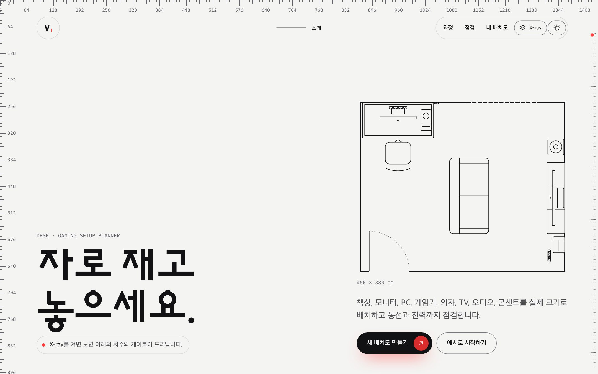
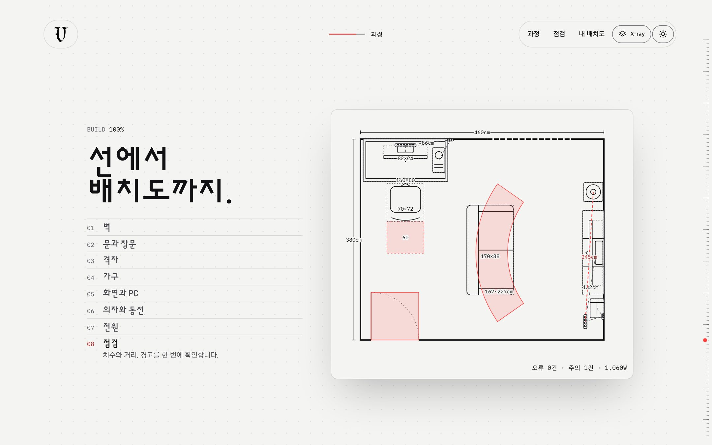
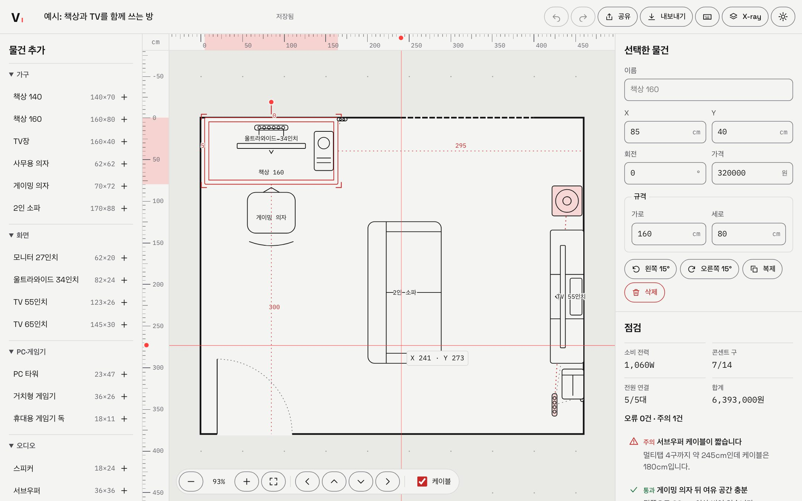
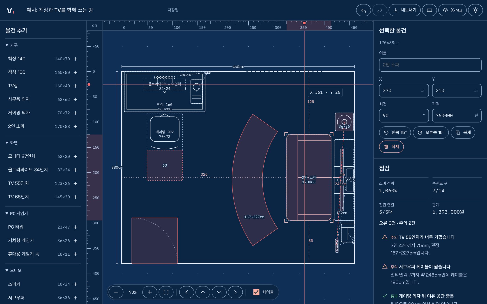
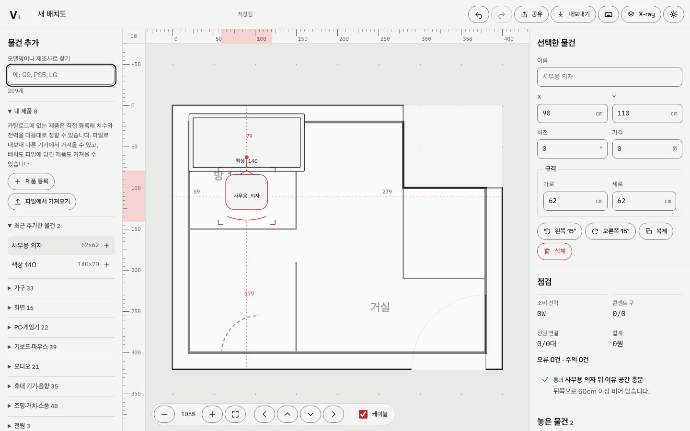
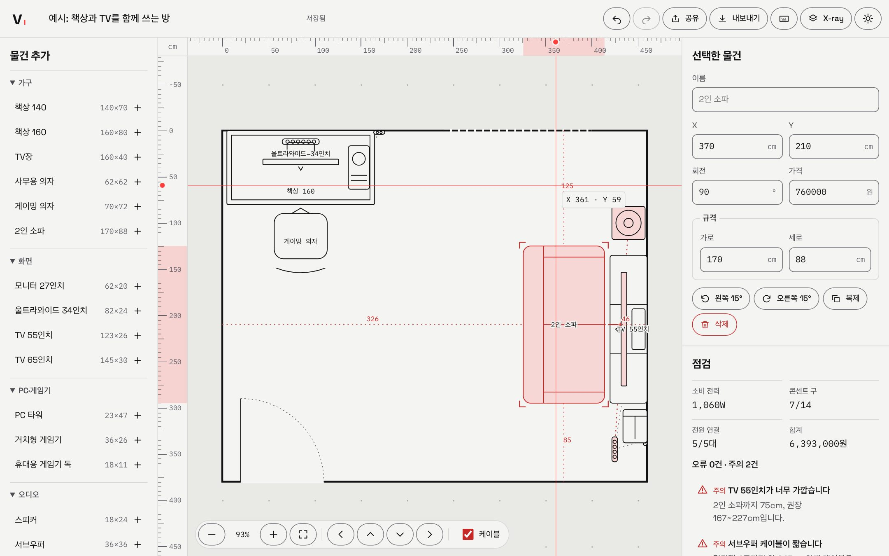
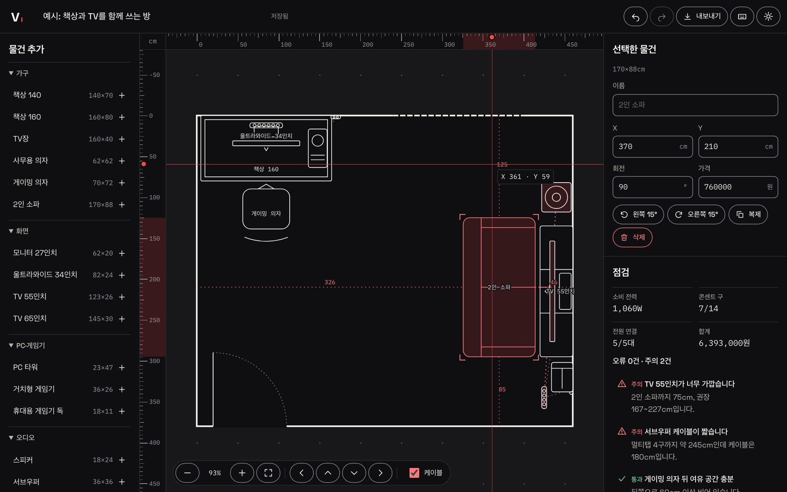
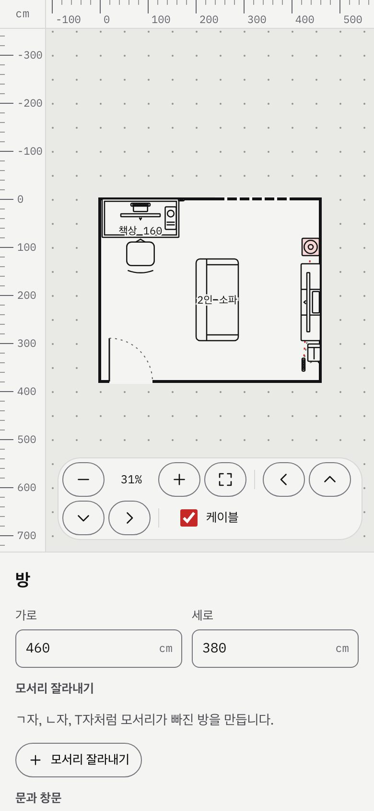

# V - 데스크·게이밍 셋업 배치도

[](https://github.com/ryushin01/V/actions/workflows/ci.yml)


책상, 모니터, PC, 게임기, 의자, TV, 오디오, 콘센트를 실제 cm 크기로 방에 배치하고 겹침, 동선, 시청 거리, 전력을 바로 점검하는 웹 앱입니다.

**[데모 바로 보기](https://v-setup-planner-ryushin01.vercel.app/)** · 첫 화면에서 **예시로 시작하기**를 누르면 됩니다.

> **프로젝트 상태:** Svelte 5 runes mode로 만든 **포트폴리오 프로젝트**입니다. 2D 배치까지 구현했고, 서버 없이 브라우저의 IndexedDB에만 저장합니다. 물건의 기본 치수와 소비 전력은 흔한 제품을 기준으로 잡은 값이며, 화면의 금액은 모두 가상 데이터입니다.

## 화면

| 첫 화면                                                                                             | 스크롤 연출                                                                        |
| --------------------------------------------------------------------------------------------------- | ---------------------------------------------------------------------------------- |
|  |  |

| 배치 편집                                                                                           | X-ray                                                                                                                   |
| --------------------------------------------------------------------------------------------------- | ----------------------------------------------------------------------------------------------------------------------- |
|  |  |

| 평면도 이미지와 ㄱ자 방                                                                                                    |
| -------------------------------------------------------------------------------------------------------------------------- |
|  |

| 점검                                                                               | 다크 테마                                             | 모바일                                                                                                 |
| ---------------------------------------------------------------------------------- | ----------------------------------------------------- | ------------------------------------------------------------------------------------------------------ |
|  |  |  |

## 주요 기능

| 구분       | 내용                                                                                                                          |
| ---------- | ----------------------------------------------------------------------------------------------------------------------------- |
| X·Y축 룰러 | 위쪽과 왼쪽에 고정된 cm 눈금, 배율에 따라 바뀌는 숫자 단위, 포인터 위치와 선택한 물건의 범위 표시, 끌어서 화면 이동           |
| X-ray      | 켜면 청사진 색으로 바뀌고 물건 치수, 케이블 길이, TV 권장 거리, 문과 의자의 여유 공간을 도면에 드러냄                         |
| 첫 화면    | 64px 눈금의 X·Y축 룰러, 끌어서 스크롤하는 오른쪽 눈금, 스크롤로 완성되는 8단계 도면, 진행률 표시                              |
| 배치       | 물건 20종 추가, 이동·회전·복제·삭제, 치수·전력·케이블·화면 크기 직접 입력, 5cm 격자와 벽 맞춤, 콘센트의 벽 고정, 문·창문 설정 |
| 방과 도면  | 모서리를 잘라 만드는 ㄱ자·ㄴ자·T자 방, 평면도 이미지 깔기, 두 점과 실제 길이로 축척 맞추기                                    |
| 겹침·동선  | 회전 사각형 SAT 겹침 판정, 문 여닫는 공간, 의자 뒤 여유 60cm, 문에서 좌석까지 폭 60cm 통로 탐색                               |
| 거리·전력  | TV 시야각 30~40° 권장 거리, 모니터 거리, 소비 전력, 멀티탭 구 수와 정격, 콘센트까지 케이블 길이                               |
| 키보드     | 방향키 10cm, Shift+방향키 1cm, `R` 15° 회전, 끌기를 대신하는 숫자 입력과 화면 이동 버튼, `aria-live` 결과 안내                |
| 터치       | 두 손가락 확대·이동, 한 손가락 끌기                                                                                           |
| 저장·공유  | 자동 저장, 되돌리기·다시 하기, JSON 내보내기·불러오기(파일 검증), 서버 없는 공유 링크(금액·이미지 제외), 라이트·다크 테마     |

## 기술 스택


| 구분       | 사용 기술                                                                                                |
| ---------- | -------------------------------------------------------------------------------------------------------- |
| 프레임워크 | Svelte 5 (runes mode), SvelteKit 3, adapter-static, TypeScript                                           |
| 상태       | class 기반 `$state`·`$derived`, `$state.raw`, `$state.snapshot`(되돌리기), `svelte/motion`, `{@attach}`  |
| 그리기     | SVG 2D, Scoped CSS와 CSS 변수                                                                            |
| 저장       | IndexedDB, JSON 파일                                                                                     |
| 품질       | Feature-Sliced Design(Steiger), ESLint, Prettier, svelte-check, Vitest, Testing Library, Playwright, axe |
| 문서·배포  | Storybook 10, GitHub Actions, Vercel(정적 배포)                                                          |

## 시작하기

Node.js 26(`.nvmrc`)과 pnpm 12가 필요합니다.

```bash
corepack enable pnpm
pnpm install
pnpm dev        # http://localhost:5173
```

| 명령                                         | 설명                                                     |
| -------------------------------------------- | -------------------------------------------------------- |
| `pnpm build` / `pnpm preview`                | 프로덕션 빌드 / 빌드 결과 실행 (`http://localhost:4173`) |
| `pnpm lint` / `pnpm lint:fsd` / `pnpm check` | ESLint / FSD 구조 / 타입 검사                            |
| `pnpm test`                                  | 단위·컴포넌트 테스트                                     |
| `pnpm test:e2e`                              | 프로덕션 빌드의 실제 화면 검사 (먼저 `build` 필요)       |
| `pnpm storybook`                             | Storybook 개발 서버 (`http://localhost:6006`)            |

## 프로젝트 구조

```
e2e/             룰러, 키보드 조작, 저장, 화면 폭, axe 검사
src/
├─ routes/       SvelteKit 라우트 (페이지를 다시 내보내기만 함)
├─ app/          전역 스타일
├─ pages/        home(첫 화면·목록), editor(배치 편집과 세션 상태), shared(공유 보기), error
├─ features/     toggle-theme, toggle-xray
├─ entities/     plan(카탈로그, 점검 계산, 저장, 평면도 그림)
└─ shared/       geometry, ruler 계산, Ruler 등 공용 UI
```

## 문서

| 문서                                 | 내용                                         |
| ------------------------------------ | -------------------------------------------- |
| [개발 가이드](docs/development.md)   | 구조 규칙, runes 사용 방식, 점검 계산의 기준 |
| [접근성 점검](docs/accessibility.md) | KWCAG 2.2 항목별 대응                        |
| [변경 기록](CHANGELOG.md)            | 버전별 변경 사항                             |
